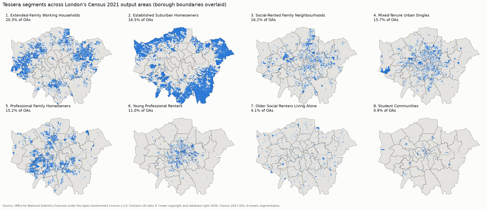
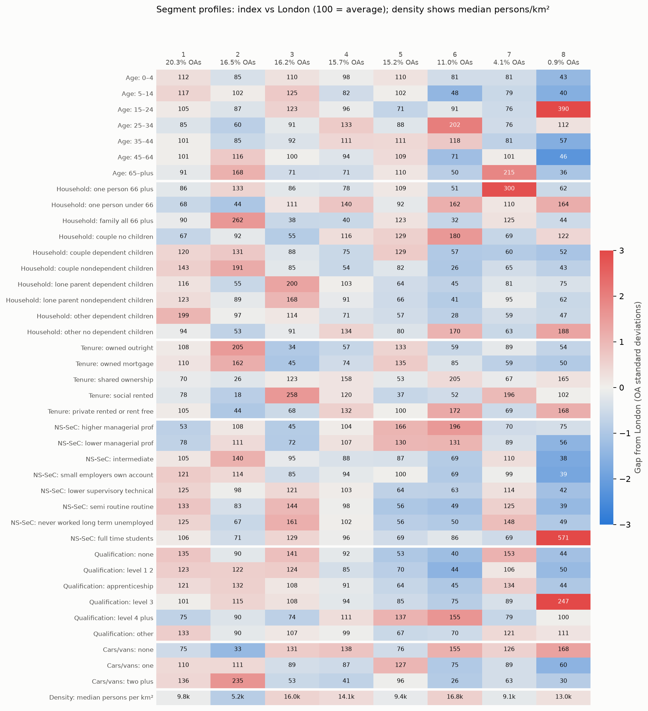
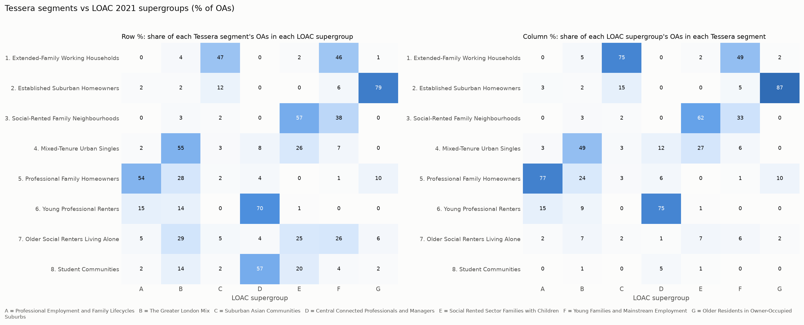
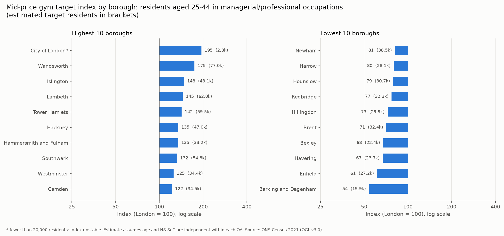

# Tessera: a demographic segmentation of London

Tessera groups London's 26,369 Census 2021 output areas (OAs) into 8 segments using
k-means on 40 Census variables, in the spirit of geodemographic classifications such
as CACI's Acorn. The segments are benchmarked against the London Output Area
Classification (LOAC), mapped with GeoPandas, scored for a hypothetical gym brand,
and published as an interactive Tableau Public dashboard.

**Dashboard:** [Tessera London Census Segmentation on Tableau Public](https://public.tableau.com/app/profile/ammar.khan4402/viz/TesseraLondonCensusSegmentation/Tessera)



## The segments

Segment IDs run from largest to smallest by number of OAs. Shares are of London's
26,369 OAs and 8,799,243 usual residents (`outputs/tables/segment_sizes.csv`).

| # | Segment | OAs | % of OAs | Residents | % of residents | Median density (per km²) |
|---|---------|----:|---------:|----------:|---------------:|-------------------------:|
| 1 | Extended-Family Working Households | 5,347 | 20.3 | 2,087,589 | 23.7 | 9,768 |
| 2 | Established Suburban Homeowners | 4,348 | 16.5 | 1,504,578 | 17.1 | 5,209 |
| 3 | Social-Rented Family Neighbourhoods | 4,275 | 16.2 | 1,470,223 | 16.7 | 16,011 |
| 4 | Mixed-Tenure Urban Singles | 4,149 | 15.7 | 1,317,460 | 15.0 | 14,099 |
| 5 | Professional Family Homeowners | 4,021 | 15.2 | 1,232,806 | 14.0 | 9,382 |
| 6 | Young Professional Renters | 2,909 | 11.0 | 802,769 | 9.1 | 16,832 |
| 7 | Older Social Renters Living Alone | 1,080 | 4.1 | 279,747 | 3.2 | 9,092 |
| 8 | Student Communities | 240 | 0.9 | 104,071 | 1.2 | 13,042 |

Names were chosen from each segment's profile against the London average
(`outputs/tables/segment_profiles.csv`, `outputs/figures/segment_profile_heatmap.png`).



## Method

### 1. Data
Seven Census 2021 topic summaries at OA level, downloaded as static Nomis bulk zips:
TS006 population density, TS007A age, TS003 household composition, TS054 tenure,
TS062 NS-SeC, TS067 qualifications and TS045 car/van availability. Boundaries and
the OA-to-borough lookup come from the ONS Open Geography Portal; London is every
OA whose `LAD22CD` starts with `E09` (32 boroughs plus the City of London). Every
source, URL and download date is in [`docs/sources.md`](docs/sources.md), and
`data/raw/manifest.json` records a SHA-256 hash for each file.

### 2. Wrangling and quality checks
Counts become percentages of **each table's own total**. Census 2021 cells are
perturbed separately per table, so an OA's resident total can differ slightly
between tables, and mixing denominators would let percentages drift off 100.
Population density is a rate, so it stays as persons per km² and enters clustering
on a log10 scale. Checks: 26,369 OAs, all unique, none dropped, and each table's
percentages sum to 100 within 0.01 points.

### 3. Segmentation
The 40 features (39 percentages plus log density) are standardised and reduced
with PCA to the 11 components that explain 80.8% of the variance. Several inputs
are strongly correlated (for example higher managerial occupations and degree-level
qualifications, r = 0.90), and PCA stops those overlapping signals from being
counted twice.

k-means (50 k-means++ starts per k) was run for k = 4 to 12:

| k | Silhouette | Smallest cluster (% of OAs) |
|--:|-----------:|----------------------------:|
| 4 | 0.201 | 18.1 |
| 5 | 0.174 | 17.1 |
| 6 | 0.179 | 0.8 |
| 7 | 0.172 | 0.9 |
| 8 | 0.175 | 0.9 |
| 9 | 0.171 | 0.8 |
| 10 | 0.172 | 0.8 |
| 11 | 0.160 | 0.7 |
| 12 | 0.146 | 0.7 |

Silhouette is almost flat from k = 5 to 10, and the elbow plot has no sharp bend,
so neither metric picks k on its own. k = 7 and k = 8 were shortlisted and tested
for stability:

| k | Mean ARI across 10 seeds | Mean ARI across 80% subsamples |
|--:|-------------------------:|-------------------------------:|
| 7 | 0.993 | 0.979 |
| 8 | 0.994 | 0.976 |

Both are highly reproducible, and k = 8 was chosen. The small cluster that appears
from k = 6 is a real group, not noise. At k = 7 it is 241 OAs where full-time
students make up 49% of residents aged 16+, against 9% London-wide
(`outputs/tables/smallest_cluster_profile.csv`). At k = 8 it becomes the 240-OA
*Student Communities* segment.

### 4. Benchmark against LOAC
Agreement with LOAC (`outputs/tables/loac_benchmark.csv`):

| LOAC level | Classes | ARI | AMI |
|------------|--------:|----:|----:|
| Supergroup | 7 | 0.381 | 0.474 |
| Group | 16 | 0.246 | 0.426 |

Across 100 random shuffles of the segment labels, ARI never exceeded 0.001, so the
agreement is far above chance. It is also far from 1, as expected: LOAC uses
variables Tessera leaves out, such as ethnicity, country of birth, language and
industry. The crosstab shows where the two schemes agree. For example, 78.5% of
*Established Suburban Homeowners* OAs fall in LOAC's *Older Residents in
Owner-Occupied Suburbs*, and 70.4% of *Young Professional Renters* OAs fall in
*Central Connected Professionals and Managers*.



### 5. Maps
GeoPandas joins segments to the OA boundaries in British National Grid (EPSG:27700)
and exports WGS84 GeoJSON for Tableau. The boundaries are not simplified any
further: even a 5 m simplify tolerance changed some OAs' areas by up to 2.5%,
above the 1% limit set in `config.py` (`outputs/tables/simplify_sweep.csv`).

### 6. Index scores: a hypothetical mid-price gym
The target customer is an adult aged 25 to 44 in a managerial or professional
occupation (NS-SeC L1 to L6). Age and NS-SeC come from separate Census tables, so
each OA's target count is estimated as residents aged 25 to 44 multiplied by the
L1 to L6 share of residents aged 16+. The index is a segment's or borough's target
share of residents divided by London's share (13.5%), times 100.

| Segment | Index | % of London's target customers |
|---------|------:|-------------------------------:|
| Young Professional Renters | 255 | 23.3 |
| Professional Family Homeowners | 139 | 19.5 |
| Mixed-Tenure Urban Singles | 125 | 18.7 |
| Established Suburban Homeowners | 75 | 12.8 |
| Student Communities | 63 | 0.7 |
| Older Social Renters Living Alone | 61 | 1.9 |
| Extended-Family Working Households | 60 | 14.1 |
| Social-Rented Family Neighbourhoods | 53 | 8.9 |

The highest-scoring boroughs are Wandsworth (175), Islington (148), Lambeth (145)
and Tower Hamlets (142). The City of London scores 195 but has only 8,586
residents, so it is flagged as too small a base to act on. The index and the reach
column answer different questions. *Extended-Family Working Households* scores only
60, but because it is the largest segment it still holds 14.1% of target customers,
about 19 times as many as *Student Communities*, whose index is similar (63). All
borough scores are in
`outputs/tables/gym_index_boroughs.csv`.



### 7. Tableau dashboard
`python -m tessera.tableau_export` writes the dashboard inputs to
`data/processed/tableau/`. [`docs/tableau_guide.md`](docs/tableau_guide.md) is the
step-by-step build guide.

## Limitations
- The gym target count assumes age and NS-SeC are independent within an OA. The
  target definition is grounded in Sport England activity rates, but it is still an
  illustration, not real membership data.
- Segments describe areas, not individuals. An OA in a segment is not made up
  entirely of people who fit the segment name.
- IMD 2025 is downloaded for validating segments but is never a clustering feature,
  because that would make the validation circular. It has not yet been used to
  profile the segments.

## Reproduce

Windows, PowerShell 5.1, conda (conda-forge only):

```powershell
conda env create -f environment.yml
conda activate tessera
pip install -e .

python -m tessera.download          # national raw files + London subsets (hashed in manifest.json)
python -m tessera.wrangle           # features + quality checks -> data/processed/oa_features.parquet
python -m tessera.segment           # step 3a diagnostics: correlations, PCA, k sweep
python -m tessera.k_stability       # step 3b: stability of the k shortlist
python -m tessera.segment --final   # step 3c: final k = 8 segments and profiles
python -m tessera.benchmark         # step 4: ARI/AMI vs LOAC
python -m tessera.maps              # step 5: maps and GeoJSON
python -m tessera.index_scores      # step 6: gym index scores
python -m tessera.tableau_export    # step 7: Tableau input files
python -m pytest
```

Raw data is never committed. The download script reproduces it.

## Repository layout

```
src/tessera/      pipeline modules; all constants in config.py
tests/            pytest: download, wrangling, quality checks, segmentation, outputs
outputs/figures/  charts and maps
outputs/tables/   every number quoted above
docs/             data sources and the Tableau build guide
```

## Data licences
Census 2021, boundaries and lookups: Source: Office for National Statistics,
licensed under the Open Government Licence v3.0. Contains OS data © Crown
copyright and database right 2023. LOAC: Greater London Authority / Consumer Data
Research Centre, OGL v3.0. IMD 2025: MHCLG, OGL v3.0.
